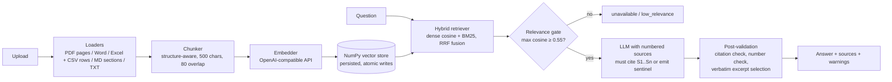

# Grounded RAG API

A small knowledge assistant that answers questions from your documents (PDF, Word, Excel, CSV, TXT, Markdown), cites
the exact passages it used, and says so when the documents don't contain the answer. It's built
with FastAPI and runs fully locally on Ollama by default. Any OpenAI-compatible provider also
works without code changes.

**Results on the included evaluation set (19 questions):** 17 of 19 passed. All 5 unanswerable
questions were refused (no hallucinated answers), every expected fact was retrieved, 156 automated
tests pass, and the two failures are analysed under [Limitations](#limitations).

---

## Quick start

### Option A: local Python (Windows / macOS / Linux)

Prerequisites: Python 3.10+ and [Ollama](https://ollama.com).

```bash
ollama pull nomic-embed-text                 # embeddings (274 MB)
ollama pull qwen3:4b-instruct-2507-q4_K_M    # LLM (2.5 GB)

python -m venv .venv
.venv\Scripts\activate          # Windows   (macOS/Linux: source .venv/bin/activate)
pip install -r requirements-dev.txt
cp .env.example .env            # optional, the defaults already target local Ollama

uvicorn app.main:app --reload --host 0.0.0.0 --port 8001   # UI: http://localhost:8001   API docs: /docs
```

### Option B: Docker

```bash
docker compose up --build       # API on http://localhost:8000, talks to Ollama on the host
```

The compose file points the container at `host.docker.internal:11434` (Ollama on the host) and
stores the index in a named volume. To use OpenAI or another hosted provider instead, set the
`RAG_*` variables in `.env` (see `.env.example`) and set `RAG_EMBEDDING_BASE_URL_DOCKER` /
`RAG_LLM_BASE_URL_DOCKER`.

### Try it

The simplest way is the web UI at **http://localhost:8000**. Drop in documents, ask a question,
and click a citation chip (`S1`, `S2`, …) to jump to its source excerpt. It's a single
dependency-free page (`app/static/index.html`) served by the API itself, so it also works in Docker.

From the command line:

```bash
# Ingest the sample documents
curl -F "files=@sample_docs/employee_handbook.md" -F "files=@sample_docs/product_faq.txt" \
     -F "files=@sample_docs/travel_expense_policy.md" -F "files=@sample_docs/information_security_policy.pdf" \
     http://localhost:8000/documents

# Ask a question
curl -X POST http://localhost:8000/query -H "Content-Type: application/json" \
     -d '{"question": "If I lose my company laptop on a business trip, how quickly must I report it?"}'
```

You can also do it without the server: `python -m app.cli ingest sample_docs` and
`python -m app.cli ask "How many days of annual leave do I get?"` (add `--workspace <name>` before
the command to use a separate library).

Example response (abridged):

```json
{
  "question": "How many days a week can I work remotely, and what do I need to do before using public Wi-Fi in a cafe?",
  "answer": "You can work remotely for up to 3 days per week [S2]. Before using public Wi-Fi in a cafe, you must be connected to the company VPN, NimbusConnect [S1].",
  "status": "answered",
  "reason": null,
  "sources": [
    {"id": "S2", "document": "employee_handbook.md", "chunk_id": "821c13dbc617:2", "page": null,
     "section": "Nimbus Analytics Employee Handbook > 2. Remote Work",
     "excerpt": "Employees may work remotely for up to 3 days per week. Tuesday is the company-wide team day, ...",
     "score": 0.7087},
    {"id": "S1", "document": "information_security_policy.pdf", "chunk_id": "7377224b5388:3", "page": 2, "section": null,
     "excerpt": "Internal systems may only be accessed from outside an office through the company VPN, NimbusConnect. Public Wi-Fi networks, such as those in cafes, airports and hotels, may be used only while NimbusConnect is active. ...",
     "score": 0.7232}
  ],
  "warnings": [],
  "max_similarity": 0.7232,
  "latency_ms": 9224
}
```

When the answer isn't in the documents:

```json
{"answer": "I could not find this information in the provided documents.",
 "status": "unavailable", "reason": "not_in_documents", "sources": [], "warnings": []}
```

## API

| Method | Path | Purpose |
|---|---|---|
| `POST` | `/documents` | Upload one or more `.pdf` / `.docx` / `.xlsx` / `.xls` / `.csv` / `.txt` / `.md` files (multipart field `files`). Re-uploading a file with the same name replaces it; identical content is a no-op (unless the parser or chunk settings changed since, in which case it is re-indexed). Indexes synchronously and returns `201`; with `?background=true` it returns `202` with one job per file instead (used by the UI). |
| `GET` | `/documents` | List indexed documents. |
| `DELETE` | `/documents/{doc_id}` | Remove a document, its chunks and its stored original. |
| `POST` | `/documents/reindex` | Re-index every stored original in the workspace in the background (e.g. after changing the chunking or description settings). |
| `GET` | `/jobs`, `/jobs/{id}` | Background ingestion jobs: `queued` → `running` (stage `parsing` / `describing` / `embedding` with `progress` 0-1 / `saving`) → `succeeded`, `failed` with an error message, or `cancelled`. |
| `DELETE` | `/jobs/{id}` | Cancel a queued job, or a running one at its next embedding batch (`409` if it already finished). |
| `GET` `POST` | `/workspaces` | List workspaces (with document and chunk counts) / create one: `{"name": "hr-team"}`. |
| `DELETE` | `/workspaces/{name}` | Delete a workspace with all its documents and files. `default` can't be deleted. |
| `POST` | `/query` | `{"question": str, "top_k"?: int, "history"?: [str]}` (`history` = earlier questions, so follow-ups like "what is his email?" work) → answer, status, reason, cited sources with verbatim excerpts, warnings. |
| `POST` | `/query/stream` | Same input. Streams newline-delimited JSON: `token` events while the model writes (an unvalidated draft), then one `final` event with the validated `/query` response (or an `error` event). Used by the UI. |
| `POST` | `/search` | Retrieval only (no LLM). Returns ranked chunks with dense and BM25 scores. Useful for debugging and evaluation. |
| `GET` | `/` | Web UI. |
| `GET` | `/health` | Liveness, plus document/chunk/workspace counts, ingestion queue depth and the configured models. |
| `GET` | `/health/ready` | Readiness: pings the embedding and LLM backends and checks the ingestion worker. `503` with the failing check when not ready. |
| `GET` | `/metrics` | Prometheus metrics (see [Operations](#operations)). |

Every document and query endpoint works on one **workspace**, selected with the `X-Workspace`
header (default: `default`). An unknown workspace is `404`, an invalid name `400`.

Error contract: `415` for an unsupported file type, `413` for a file over `RAG_MAX_UPLOAD_MB` or one
that would produce more than `RAG_MAX_CHUNKS_PER_DOCUMENT` chunks, `422` for an
empty/corrupt file or an invalid request, `503` when the embedding or LLM backend is unreachable
(internal details are not leaked), and `409` when the stored index was built with a different
embedding model or a workspace name is taken. A batch upload is validated in full before anything is indexed, so one bad file
rejects the whole batch.

`status` is `answered` or `unavailable`. `reason` explains every abstention:

| reason | meaning |
|---|---|
| `no_documents` | Nothing has been ingested yet. |
| `low_relevance` | No chunk is semantically close to the question, so the LLM is not called. |
| `not_in_documents` | The LLM reported that the sources don't contain the answer. |
| `ungrounded_answer` | The LLM answered without citing any provided source, so the answer was discarded. |

## Architecture



```
app/
  config.py           settings from env vars / .env (pydantic-settings, prefix RAG_)
  models.py           domain dataclasses (Section, Chunk, Answer, Source, ...)
  ingestion/
    loaders.py        PDF (pypdf, per page), Word .docx (heading styles, or bold/ALL-CAPS lines when
                      a document has none, lists, tables), splits "Email: .. | Phone: .." lines,
                      Excel .xlsx/.xls and CSV (one section per sheet; each row becomes
                      "Row N | Column: value; ...", so a chunk makes sense without the header row),
                      Markdown (heading-aware), TXT; encoding fallback
    chunker.py        paragraph > line > sentence > word splitting, greedy packing with overlap
    context.py        LLM-written document type + subject, indexed with each document's first chunk
  embeddings.py       OpenAI-compatible embedder + deterministic hashing embedder for tests
  vectorstore.py      NumPy matrix + JSON metadata, exact cosine search, atomic persistence
  retrieval.py        BM25 index + Reciprocal Rank Fusion with dense search
  llm.py              OpenAI-compatible chat client (strips <think> blocks)
  qa.py               prompt, follow-up handling, abstention logic, citation validation, excerpts
  service.py          composition root: workspaces (index + retriever + QA + stored originals),
                      ingestion, used by the API, the CLI and the evaluation
  jobs.py             background ingestion queue (single worker thread, stages, job history)
  observability.py    request IDs, text/JSON logs, Prometheus metrics, stage timers, ASGI middleware
  api/                FastAPI routes + request/response schemas
  main.py             app factory, error-to-HTTP mapping, logging setup, worker start/stop
  cli.py              `ingest` / `ask` without running the server
eval/                 questions.json, run_eval.py, results/
sample_docs/          4 fictional company documents (PDF, TXT, 2x MD)
tests/                156 offline tests (no model backends needed)
```

## Operations

**Workspaces.** Each workspace is an independent document library with its own index and its own
folder of original files; the models are shared. `default` lives directly in `RAG_DATA_DIR` (so
indexes created before workspaces existed keep working), the others in
`RAG_DATA_DIR/workspaces/<name>/`. The UI has a workspace switcher; the API uses the `X-Workspace`
header.

**Reliable uploads.** Every upload is validated (type, size, parseable text, chunk count) in the
request, so bad files still fail fast with `415` / `413` / `422`. The original bytes are then written to
`<workspace>/files/<doc_id>/` *before* indexing starts. Background indexing runs on a single
worker thread (one at a time is deliberate: describing and embedding keep the local model busy, and
parallel jobs would only slow every upload and every question). Because the original is already on
disk, nothing is lost if the server stops mid-way: at startup, any stored file whose index entry is
missing or out of date is queued again. If the model backend is down, the job fails with a clear
message and is retried on the next restart or `POST /documents/reindex`. A file that can never be
indexed (unparseable, too many chunks) or whose job is cancelled is removed, so it isn't retried. A
failed document description never blocks indexing; the document is indexed without it.

**Large files.** Indexing time depends on how much *text* a file holds, not on its size: embedding
is the slow step, and images inside a PDF or Word file cost nothing. Measured on the development
laptop (Quadro T2000, 4 GB), `nomic-embed-text` embeds about **12 chunks per second** (sending
requests in parallel doesn't help; the GPU is the limit):

| 25 MB test file | Chunks | Parse | Result |
|---|---|---|---|
| PDF (1 MB of text + scanned image) | 2,369 | 3 s | indexed in 3 min 49 s; needle question answered correctly |
| Word `.docx` (same mix) | 2,369 | 6 s | ~3.5 min |
| Excel `.xlsx` (1 MB of rows + image) | 4,917 | 2 s | ~7 min |
| TXT (all text) | 59,211 | 4 s | rejected: over the chunk limit (~1.4 h to embed) |
| CSV (all text) | 122,931 | 2 s | rejected: over the chunk limit (~2.8 h to embed) |

Times marked `~` are estimated from the chunk count at 12 chunks/s; the PDF row was measured end to end.

So uploads are capped twice: `RAG_MAX_UPLOAD_MB` (default 50) bounds the request, and
`RAG_MAX_CHUNKS_PER_DOCUMENT` (default 20,000, about 30 minutes here) rejects a file up front, with
the chunk count in the message, instead of letting it occupy the worker for hours. Raise either in
`.env` if you can wait (or use a faster embedding backend). While a job runs, the UI shows
"Embedding 42%" with a progress bar and a cancel button; the API exposes the same as `progress`
on `/jobs/{id}` and `DELETE /jobs/{id}`.

To try it yourself:

```bash
python scripts/make_large_files.py --size-mb 25 --out large_test_files    # PDF, DOCX, XLSX, CSV, TXT
```

Upload the files in the UI (or `curl -F "files=@large_test_files/large_tickets.pdf"
"http://localhost:8001/documents?background=true"`), watch the progress, then ask *"What is the
access code for the Halden archive vault?"*. The answer, `7319-KESTREL`, is planted once in the
middle of every file. `--text-mb` controls how much text the PDF/DOCX/XLSX files contain.

**Observability.**

- *Request IDs:* every response carries `X-Request-ID` (a valid incoming one is reused, otherwise
  one is generated). The ID is on every log line written while handling the request, including
  the background job it started.
- *Logs:* one line per request (method, route, status, duration) plus events such as
  `document_indexed` (chunks and parse/describe/embed milliseconds) and `answered` (status,
  reason, sources, retrieval/generation milliseconds; never the question text or the answer).
  `RAG_LOG_FORMAT=json` writes one JSON object per line with the same fields as keys.
- *Metrics* at `/metrics`, in Prometheus text format:

| Metric | Type | Labels |
|---|---|---|
| `http_requests_total` | counter | method, route template, status |
| `http_request_duration_seconds` | histogram | route (streamed responses are timed to their last byte) |
| `rag_stage_duration_seconds` | histogram | stage: `retrieval`, `generation`, `ingest_parse`, `ingest_describe`, `ingest_embed` |
| `rag_answers_total` | counter | status, reason, cached |
| `rag_ingest_jobs_total` | counter | status |
| `rag_documents`, `rag_chunks` | gauge | workspace |
| `rag_ingest_queue_depth` | gauge | |

- *Health:* `/health` is a cheap liveness check; `/health/ready` also pings Ollama/the provider
  (3 s timeout) and returns `503` when a backend is unreachable, for load balancers and container
  orchestrators.
- *Per-answer timings:* `/query` responses include `timings` (`retrieval_ms`, `generation_ms`,
  `first_token_ms` when streaming) and `cached`. The UI shows them on hover over the latency.

## Design decisions and trade-offs

**Grounding is enforced in layers, not trusted to the prompt.** The main failure mode of RAG is a
fluent answer that isn't supported by the documents, so no single component is relied on:

1. A **retrieval gate** abstains before calling the LLM when the best cosine similarity is below
   `RAG_MIN_RELEVANCE`. In the evaluation, "Who won the 2022 FIFA World Cup?" (which the LLM
   knows from training) scored 0.48 and was refused in 80 ms. On-topic questions scored ≥ 0.70.
   The gate is intentionally conservative: in-domain unanswerable questions (CEO, parental leave)
   score 0.63–0.75, so they are left to the next layer.
2. The **prompt contract** allows only the numbered sources, requires `[Sn]` citations on every
   factual sentence, and requires a sentinel token (`INSUFFICIENT_INFORMATION`) when the sources
   don't answer the question. Source text is explicitly marked as data, not instructions.
3. **Post-validation** in code: answers with no valid citation are discarded
   (`ungrounded_answer`), citations to sources that were never provided are stripped, and any
   number in the answer that doesn't appear in the cited sources (or the question) produces a
   warning. A sentinel appended to an otherwise cited answer is treated as a partial answer with
   a warning instead of throwing away a correct answer. The first evaluation run caught exactly
   this case.
4. **Evidence is never generated.** Excerpts are verbatim sentence windows cut from the stored
   chunk, chosen by overlap with the question and the answer sentences citing that source. The
   evidence shown to the user cannot be hallucinated, even if the answer is wrong.

**Only cited sources are returned.** The response lists the sources the answer actually cites, not
every retrieved chunk, so the evidence matches the claims.

**Chunking.** Chunks never cross a PDF page or Markdown section, so every citation has one page or
heading. Each chunk is embedded with a short context header (`doc name > section path`), which
helps short chunks like "Up to 10 unused days may be carried over" retrieve for questions that
mention leave. I tested 900, 700 and 500-character chunks. 500 was best: larger chunks diluted
focused facts (for example, the data-retention chunk dropped out of the top 6 at 700).

**Hybrid retrieval (dense + BM25 with Reciprocal Rank Fusion).** Dense embeddings handle
paraphrase ("time off" vs. "annual leave"), and BM25 handles exact tokens such as plan names,
acronyms (SAML, TLS) and numbers, which small embedding models blur. RRF merges the two rankings
without calibrating their score scales. *Honest result:* on this corpus, hybrid did not beat
dense-only. Both are perfect at `top_k=5` and above, and at `top_k=3` dense-only scored slightly higher
(source recall 1.0 vs 0.964; BM25 pulled travel-policy chunks above the security policy for the
lost-laptop question). I kept hybrid on by default for the exact-token robustness that real
corpora need, and it can be switched off with `RAG_HYBRID_SEARCH=false`. A larger, more varied
evaluation set should decide this.

**Vector store: NumPy, not a database.** Exact brute-force cosine search over an in-memory matrix
has no infrastructure, is deterministic, and is fast at this scale (about 50k chunks × 768 dims
≈ 150 MB, searched in milliseconds). Persistence is a `.npy` file plus JSON metadata written
atomically (temp file + `os.replace`). The index records which embedding model built it and
refuses to load under a different one, instead of silently returning garbage similarities. The
store sits behind a narrow interface (`add_document`, `delete_document`, `similarities`,
`chunks`), so moving to Qdrant or pgvector is a contained change once the corpus or concurrency
outgrows a single process.

**Model access via OpenAI-compatible HTTP.** One small `httpx` client covers OpenAI, Ollama,
Groq, vLLM and LM Studio, without pulling in vendor SDKs. The defaults are fully local (Ollama,
`nomic-embed-text` + `qwen3:4b-instruct`), so the project runs without API keys or cost. The
nomic task prefixes (`search_query:` / `search_document:`) are configurable and must be blanked
for OpenAI models. Temperature is 0 for reproducibility.

**Finding a document by what it is.** People ask about "the resume" or "the offer letter", but a CV
never contains the word "resume", so neither BM25 nor the embeddings can connect the two. At
ingestion the LLM writes a two-line catalogue entry per document (`Type:` the kind of document plus
synonyms, e.g. "resume, CV, professional profile"; `About:` who or what it is about). The entry is
embedded and BM25-indexed with the document's **first chunk only**, and the retriever always adds the
first chunk of the top retrieved document (`RAG_DOCUMENT_LEAD_CHUNKS`), which is where names, titles and
contact details live. My first version added the entry to every chunk; that blurred the chunks and
dropped eval retrieval recall from 1.0 to 0.96, so it is now on the first chunk only (recall back to
1.0, answers unchanged). The entry is never shown to the answering LLM as a source, so generated text
can't become evidence. It costs one LLM call (~10 s locally) per uploaded document.

**Follow-up questions.** The UI sends earlier questions as `history`. If a question looks like a
follow-up (it uses he/his/it/that/they..., starts with "and" / "what about", or is a single word), the earlier question(s) back to the
last self-contained one are added to the search query, and shown to the LLM only to resolve the
reference. Self-contained questions ignore history, so changing topic doesn't drag old context along.
This avoids an extra LLM call to rewrite the question.

**Idempotent ingestion.** A document's ID is derived from its file name. Re-uploading the same
content is a no-op, and changed content replaces the old chunks atomically.

## Performance

On the test laptop (Quadro T2000, 4 GB VRAM), retrieval takes about 0.1 s and almost all the
time goes to the LLM. The 2.5 GB model plus its context doesn't fit in VRAM, so about a third of
it runs on the CPU and it writes roughly 8–14 tokens per second. Measured changes:

| Change | Effect |
|---|---|
| Streaming (`/query/stream`, used by the UI) | First words appear after about 5 s instead of the user waiting 20–30 s for the full answer. Citations are still validated on the complete answer, which replaces the draft. |
| `top_k` 8 → 6 (recall unchanged) and a "1–3 sentences" prompt rule with a 350-token cap | Median full-answer time on the evaluation set fell from 9.1 s to 4.8 s, with the same 17/19 pass rate. |
| `keep_alive=30m` + warm-up at startup | Avoids the 7–8 s model reload after idle periods and on the first question. |
| Answer cache keyed on question + index version | Repeated questions return in about 0.01 s. Uploading or deleting a document invalidates it. |

For a much bigger speed-up, use a model that fits fully in VRAM (for example a 1.7B model, at
some cost in answer quality) or a hosted API. Both only need a change to `.env`.

## Evaluation

```bash
python -m eval.run_eval                                # full pipeline -> eval/results/report_full.md
python -m eval.run_eval --retrieval-only --top-k 3     # retrieval metrics only
python -m eval.run_eval --retrieval-only --no-hybrid   # dense-only ablation
```

`eval/questions.json` has 19 questions over the four sample documents. The documents describe a
fictional company, so the model cannot answer from prior knowledge, which makes grounding
measurable.

- **9 answerable**: single facts, plus a false-premise question (A8) and one that requires
  applying a general rule (A9).
- **5 multi-evidence**: need facts from two documents (M1, M2) or several sections (M3–M5).
- **5 unanswerable**: in-domain gaps (parental leave, CEO, retirement fund, headcount) and an
  out-of-domain trap the LLM knows the answer to (FIFA World Cup).

Each question lists its expected source documents and required facts. A question passes if it's
answered, contains every required fact, and at least half of its citations point to an expected
document. Unanswerable questions must come back `unavailable`.

### Results (Ollama, `nomic-embed-text` + `qwen3:4b-instruct-2507` Q4, CPU/consumer GPU)

| Metric | Value |
|---|---|
| Overall pass rate | **17 / 19 (89.5%)** |
| Unanswerable questions correctly refused | **5 / 5 (100%)**, 0 hallucinated answers |
| Answerable + multi-evidence pass rate | 12 / 14 (85.7%) |
| Multi-evidence pass rate | 5 / 5 |
| Retrieval source recall / MRR (top-6) | 1.00 / 1.00 |
| Context recall (all required facts present in retrieved chunks) | 1.00 |
| Citation precision | 0.93 |
| Median latency (full answer) | 4.8 s (local 4B model; the out-of-domain refusal takes 40 ms) |

Retrieval ablation at `top_k=3`:

| | source recall | context recall (multi-evidence) |
|---|---|---|
| Hybrid (dense + BM25) | 0.964 | 0.90 |
| Dense only | 1.00 | 1.00 |

Full per-question tables and every generated answer are in
[`eval/results/report_full.md`](eval/results/report_full.md).

**The two failures:**

- **A8, false premise** ("Since the Starter plan includes SAML SSO, how do we turn it on?"): the
  model refused instead of correcting the premise (SAML is Enterprise-only). This is a safe
  failure, since it says nothing wrong, but it's unhelpful.
- **A9, rule application** (hotel limit in Paris): the model answered USD 250, treating the four
  explicitly listed high-cost cities as "by extension, other international cities". The correct
  answer is USD 180. This is a real grounding error with a valid-looking citation. The
  number-in-source check can't catch it, because 250 does appear in the cited chunk. Adding
  explicit prompt rules for both cases didn't change the 4B model's behaviour. I kept the rules
  but didn't tune the prompt further against the evaluation set, to avoid overfitting.

## Tests

```bash
pytest            # 156 tests, about 8 s, no network or models needed
```

The tests use a deterministic hashing embedder and a scriptable fake LLM, so they check the
system's own logic rather than model behaviour. The last run's output is in
[`eval/results/test_results.txt`](eval/results/test_results.txt).

| File | Covers |
|---|---|
| `test_ingestion.py` | Markdown heading paths, code blocks, encodings, PDF page numbers, unsupported/empty/corrupt files, chunk size and overlap, oversized paragraphs |
| `test_spreadsheets.py` | Excel and CSV: header detection (title rows above the table, blank or missing headers), row numbers matching Excel, dates/percentages/booleans, multiple sheets, legacy `.xls`, CSV delimiter and encoding detection, corrupt files, retrieving and citing the right row |
| `test_retrieval.py` | Vector ranking, persistence and reload, re-ingest replacement, delete, embedder/dimension mismatch, stemming, BM25, sample-corpus retrieval, multi-document coverage |
| `test_qa.py` | Cited answers and verbatim excerpts, sentinel, partial answers, uncited answers rejected, unknown citations stripped, grouped citations, unsupported-number warnings, relevance gate and empty index (LLM not called), LLM errors |
| `test_model_clients.py` | HTTP clients against a mocked transport: error wrapping, connection failures, `<think>` stripping, vector ordering and normalisation, embedding prefixes |
| `test_api.py` | Every endpoint: upload of all three formats, idempotency, replacement, 415/413/422, atomic batch rejection, delete/404, validation, 503 without leaking internals, path-traversal file names |
| `test_context.py` | Document descriptions: parsing, LLM-failure fallback, first-chunk-only indexing, type words become searchable, never shown to the answering LLM; follow-up detection and history-aware retrieval |
| `test_production.py` | Workspaces (CRUD, name validation, isolation, persistence, deletion), background jobs (progress, failure keeps the original, resume at startup, reindex, cancelling queued and running jobs, unparseable files not retried), chunk limit, request IDs, `/metrics` (route templates, not raw paths), readiness checks, JSON logs, timings and cache flag |
| `test_eval.py` | Question-set integrity, fact matching, expected facts actually present in the sample docs, offline retrieval evaluation |

## Configuration

Settings come from environment variables (prefix `RAG_`) or `.env`; see `.env.example`. The most
important ones:

| Variable | Default | Notes |
|---|---|---|
| `RAG_LLM_BASE_URL` / `RAG_LLM_MODEL` / `RAG_LLM_API_KEY` | Ollama, `qwen3:4b-instruct-2507-q4_K_M` | Any OpenAI-compatible endpoint. |
| `RAG_EMBEDDING_BASE_URL` / `RAG_EMBEDDING_MODEL` / `RAG_EMBEDDING_API_KEY` | Ollama, `nomic-embed-text` | Changing the model requires re-ingesting documents. |
| `RAG_MIN_RELEVANCE` | `0.55` | Calibrated for `nomic-embed-text`. **Re-calibrate per embedding model** with `/search` or the evaluation. |
| `RAG_TOP_K` | `6` | Chunks passed to the LLM. Recall is perfect down to 5 on the eval set; fewer chunks mean a shorter prompt and a faster first token. |
| `RAG_CHUNK_SIZE` / `RAG_CHUNK_OVERLAP` | `500` / `80` | Characters. |
| `RAG_HYBRID_SEARCH` | `true` | BM25 + dense fusion. |
| `RAG_DOCUMENT_CONTEXT` | `true` | Have the LLM describe each uploaded document (type + subject) for retrieval. Adds one LLM call per upload. |
| `RAG_DOCUMENT_LEAD_CHUNKS` | `1` | Also pass the first chunk of up to this many retrieved documents whose first chunk wasn't already retrieved. A document's opening (title, a CV's name and contact details, contract parties) rarely shares words with questions like "what is the name in the resume?". Eval scores and latency are unchanged at `1`; `2` added ~1.4 s per answer. `0` disables. |
| `RAG_MAX_UPLOAD_MB` | `50` | Per file. |
| `RAG_MAX_CHUNKS_PER_DOCUMENT` | `20000` | Files that would produce more chunks are rejected with `413` (see [Large files](#operations)). |
| `RAG_LLM_MAX_TOKENS` | `350` | Upper bound on answer length. |
| `RAG_KEEP_ALIVE` | `30m` | Ollama only: keeps models loaded between questions. **Set it empty for OpenAI**, which rejects unknown parameters. |
| `RAG_WARMUP` | `true` | Loads the models in the background at startup so the first question isn't slowed by loading. |
| `RAG_ANSWER_CACHE_SIZE` | `256` | Repeated questions on an unchanged index are answered instantly. Set `0` to disable. |
| `RAG_DATA_DIR` | `data` | Indexes and stored originals for all workspaces (`/data` volume in Docker). |
| `RAG_LOG_FORMAT` / `RAG_LOG_LEVEL` | `text` / `INFO` | `json` for one JSON object per line. |

## Limitations

- **Reasoning is bounded by the LLM.** With a 4B local model, rule application (A9) and premise
  correction (A8) fail. The guardrails catch missing or invalid citations and invented numbers,
  but not a wrong inference from a correctly cited source. A stronger model (for example
  `gpt-4o-mini`, configurable via `.env`) or an LLM-based claim-verification pass would be the
  next step.
- **Small evaluation set.** 19 questions over 35 chunks is enough to catch regressions and show
  behaviour, not to make statistically strong claims. Retrieval is nearly saturated at `top_k=6`
  on a corpus this small, so the hybrid-vs-dense comparison is inconclusive.
- **Relevance threshold is model-specific** and was set by hand from the observed score
  distributions (off-topic ≤ 0.53, on-topic ≥ 0.70). It needs re-calibrating for other embedding
  models or very different corpora.
- **Fact matching in the evaluation is lexical** (with listed alternatives), so a correct
  paraphrase that uses none of them would count as a miss.
- **No OCR.** Scanned PDFs have no extractable text and are rejected with `422`. Tables and
  multi-column layouts are extracted as plain text, so their structure is lost.
- **Word: `.docx` only.** Legacy binary `.doc` files are rejected with `415` and a hint to re-save
  as `.docx`. Headers, footers, comments and text boxes are not indexed.
- **Spreadsheets are searched row by row, not computed over.** Questions about specific rows
  ("what is Karthik's salary?", "which orders are pending?") work. Totals, averages and counts
  over a whole sheet don't, because the LLM only sees the few retrieved rows. Formulas are read as
  the value Excel last saved, charts and images are ignored, and a very wide row (longer than the
  chunk size) is split across chunks.
- **Single-process design.** The NumPy indexes live in memory and are guarded by locks, the
  ingestion queue is an in-process thread, and job history and metrics are kept in memory (job
  history is lost on restart, though unfinished files are re-queued). Running several API
  workers or replicas would need a shared vector database, an external queue and a metrics
  backend.
- **No authentication or rate limiting.** Workspaces separate document libraries but are **not
  access-controlled**: anyone who can reach the API can use any workspace. An API gateway or
  auth layer is required before exposing the service publicly.
- **Follow-up detection is a heuristic** (pronouns, "and" / "what about", one-word questions). A
  question like "where did the candidate study?" after a question about a different CV is
  answered on its own. An LLM rewrite step would be more general but
  adds a model call per question.
- **No query decomposition.** Multi-hop questions rely on `top_k` being large enough. In testing,
  LLM-generated sub-queries fixed a multi-hop retrieval miss but added about 17 s per question
  on the local model, so I left them out. It would be worth adding as an option with a faster
  LLM.

## Regenerating the sample PDF

`python scripts/make_sample_pdf.py` (needs `reportlab`, which is in `requirements-dev.txt`).
Large test files for upload testing: `python scripts/make_large_files.py` (see [Operations](#operations)).
